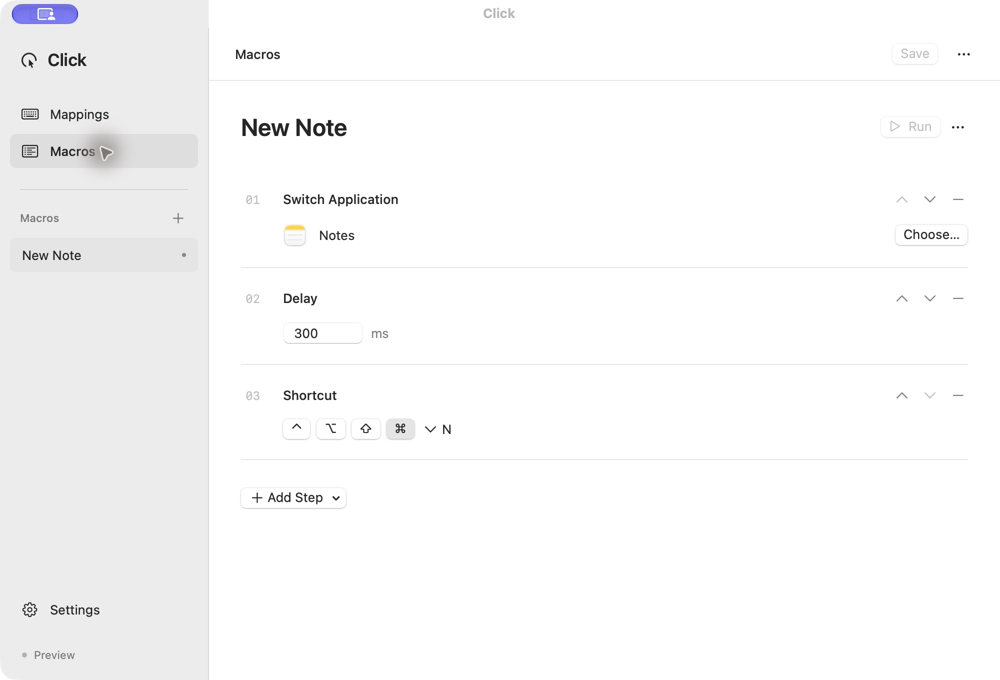

# Click

[中文](README.zh.md)

A small native macOS app for per-device key mappings and keyboard macros. Runs in the menu bar after its window closes.



## Features

- **Per-device mappings.** Give each keyboard its own layout. Remap a key to another key or a reusable macro.
- **Ordered macros.** Switch to an application, wait, send a shortcut, or type Unicode text. Reorder steps in the editor.
- **Load and export.** Versioned JSON files contain devices, mappings, and macros. Imported changes remain a draft until saved.
- **Background operation.** Close the window and keep your mappings running. Pause, cancel a macro, or quit from the menu bar.
- **Launch at login.** Enable it in Settings. macOS may require approval in Login Items.
- **Local only.** No account, network service, shell execution, analytics, or keyboard history.

## Install

Requires **macOS 14+**. The initial UI is in Chinese.

Download an architecture-matching app from [Releases](https://github.com/MrCroxx/click/releases), unzip it, and move **Click.app** to Applications before granting permissions or enabling launch at login. Builds are ad-hoc signed, not notarized; building from source is also supported.

1. Open Click and grant **Accessibility** and **Input Monitoring** in Settings when needed.
2. Select **Add device**, choose a connected keyboard, and add mappings.
3. For a macro, first create its steps in the macro editor, then assign it to a key.
4. Enable the device profile and click **Save and apply**.
5. Enable **Launch at login** if desired.

Adding a device starts with mappings disabled. Saving applies only enabled profiles. Pausing restores the previous mappings; starting resumes the last saved configuration. Closing the window keeps the service running. Quitting restores mappings and stops it.

## Build

Use a Swift 6 toolchain on macOS, with Xcode or Command Line Tools installed.

```sh
make test
make dev
make release
```

`make release` creates `build/Click.app` and `build/Click-macOS-<arch>.zip` for the build machine's architecture. Set `SIGNING_IDENTITY` to use your own signing identity. For an isolated UI preview with sample data and no keyboard access:

```sh
make demo
```

`Click.app/Contents/MacOS/Click --background` starts with no window. The app is a **user-session background agent**: login startup uses `SMAppService.mainApp`, and input actions require a logged-in graphical session. It is not a root LaunchDaemon running before login. A crash requires reopening the app; there is no separate watchdog.

## Configuration and recovery

Files live in `~/Library/Application Support/Click/`:

- `config.json` — atomically saved, validated configuration, restricted to the current user.
- `recovery.json` — previous and applied HID mappings, written before changing the system.

Device identity uses vendor/product and serial number when present, otherwise the connection location. Devices without serial numbers may need a new profile after changing USB ports. Multiple keyboard interfaces with the same identity share a profile. Connected devices are checked every two seconds, and the saved mappings are reapplied after a connection change.

On pause, normal quit, or the next startup after a crash, Click restores the keys it still owns and preserves unrelated changes made by other software. A forced kill can leave mappings active until Click is reopened or the keyboard disconnects/system restarts. Do not delete the recovery file before restoring. Corrupt configuration or recovery files produce an error rather than being silently overwritten. Exported configuration can contain device serial numbers and macro text; review it before publishing.

## Current limits

- Ordinary keyboard-page keys are supported, including left/right modifiers. Fn, media keys, mouse buttons, gestures, and device firmware programming are not included.
- Mapping triggers are single physical keys, not shortcut chords. Use a macro to emit a shortcut chord. Modifier keys cannot trigger macros.
- Macros use **F13–F20 as reserved channels**, up to **8 enabled macro bindings across all profiles**. Those reserved function keys on any keyboard also trigger their assigned macros. Do not use them for other shortcuts while the profiles are enabled. Ordinary one-to-one mappings do not consume a channel.
- Key mappings are based on physical key positions. Unicode text is a separate macro action; text injection may not work in secure input fields or apps that reject synthetic events.
- A single macro runs at a time. Repeated/overlapping triggers are ignored. Application activation has a five-second deadline. After an application step, the foreground app is checked before each following step; a mismatch stops execution. Application launching already requested from macOS cannot be undone by cancellation.
- Keyboard tools that seize a physical device (such as Karabiner-Elements) can prevent its native HID mappings from taking effect. Disable competing device handling for keyboards managed by Click. Virtual keyboards appear as separate devices.
- The backend uses Apple's `UserKeyMapping` property and a Core Graphics event tap. macOS/device permission restrictions can reject mappings; Click checks the write result and reads it back. It does not install a privileged helper to bypass restrictions. Secure Input can prevent macro interception. Avoid relying on macros in password fields.
- Login permissions, physical key delivery, Bluetooth reconnection, and behavior under Secure Input need validation on the target Mac. Automated tests verify configuration, restoration, and macro sequencing with simulated application/output adapters; they do not certify hardware behavior.

## Development

`ClickCore` contains the configuration schema, key catalog, mapping compiler, and ownership-aware restoration logic. `Click` contains the SwiftUI editor, AppKit menu bar, HID backend, macro executor, and login integration. CI runs tests and uploads an app archive.

The architecture was informed by [Olanzi](https://github.com/MrCroxx/olanzi)'s native macro and lifecycle implementation; this repository has an independent UI and general keyboard backend. Relevant Apple documentation: [key remapping](https://developer.apple.com/library/archive/technotes/tn2450/) and [login registration](https://developer.apple.com/documentation/servicemanagement/smappservice/register()).

MIT licensed. Contributions and device compatibility reports are welcome.
